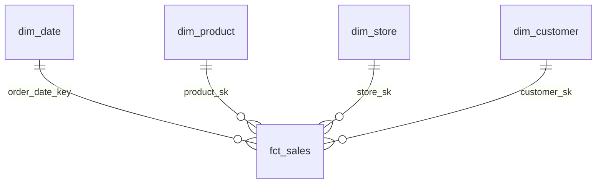

# Phase 9 — Data Modeling

**Weeks:** 10 · **Time:** ~10 h (4 h theory, 6 h hands-on)
**Goal:** Design Gold-layer models that are easy to query, correct and maintainable.

> **Mentor note:** Bad models create endless "why don't these numbers match?" tickets. The first question in modeling is always **"what is the grain?"**, meaning what one row represents. Get into the habit of writing the grain as a comment at the top of every table you build.

---

## 1. Facts and dimensions

**Simply:** **Facts** are *events you measure* (a sale, a flight, a payment). **Dimensions** are the *context you slice by* (who, what, where, when).

| | Fact table | Dimension table |
|---|---|---|
| Example | `fct_sales`: one row per order line | `dim_product`: one row per product (version) |
| Contains | Foreign keys + numeric measures (quantity, amount) | Descriptive attributes (name, category, brand) |
| Size | Large, grows fast | Smaller, changes slowly |
| Types | **Transaction** (per event), **periodic snapshot** (daily balance), **accumulating snapshot** (order lifecycle milestones) | Conformed (shared across facts), junk, role-playing (`dim_date` as order date and ship date) |

**Additive measures** (amount) can be summed across all dimensions. **Semi-additive** (account balance) can't be summed across time. **Non-additive** (ratios like average order value) should be computed from additive parts, never by averaging averages.

## 2. Star vs snowflake schema

```
STAR (recommended for Gold/BI)                SNOWFLAKE
          dim_date                              dim_date
              │                                    │
dim_store ── fct_sales ── dim_product        dim_store ── fct_sales ── dim_product ── dim_category ── dim_department
              │                                    │
         dim_customer                         dim_customer ── dim_city ── dim_country
```
- **Star:** dimensions denormalised (category name stored in `dim_product`). Fewer joins, faster and simpler for BI. **The default for Gold.**
- **Snowflake:** dimensions normalised into sub-dimensions. Less redundancy, more joins. Use it when a hierarchy is large or shared.

## 3. Keys

| Key | What | Example |
|---|---|---|
| **Business (natural) key** | Identifier from the source system | `product_code = 'SKU-1042'` |
| **Surrogate key** | Warehouse-generated, meaningless | `product_sk = 98123` |
| **Primary key** | Uniquely identifies a row | `product_sk` in `dim_product` |
| **Foreign key** | Points to a dimension PK | `fct_sales.product_sk` |

**Why surrogate keys?** SCD2 needs several rows per business key (one per version); sources can reuse or change codes; multiple sources can collide. Generate them with `GENERATED ALWAYS AS IDENTITY` or a deterministic hash (`xxhash64(business_key, effective_from)`).

**Constraints in Databricks:** `PRIMARY KEY` / `FOREIGN KEY` constraints on UC tables are **informational** (not enforced). They help BI tools and the optimiser and they document intent, but **you must still test uniqueness and referential integrity yourself** (Phase 11). `NOT NULL` and `CHECK` constraints **are** enforced.

```sql
CREATE TABLE gold.dim_product (
  product_sk BIGINT GENERATED ALWAYS AS IDENTITY,
  product_code STRING NOT NULL,
  product_name STRING, category STRING,
  effective_from TIMESTAMP NOT NULL, effective_to TIMESTAMP, is_current BOOLEAN NOT NULL,
  CONSTRAINT pk_dim_product PRIMARY KEY (product_sk)
) COMMENT 'Grain: one row per product version (SCD2)';

CREATE TABLE gold.fct_sales (
  order_line_id BIGINT NOT NULL, order_date_key INT NOT NULL,
  product_sk BIGINT NOT NULL, store_sk BIGINT NOT NULL,
  quantity INT, net_amount DECIMAL(12,2),
  CONSTRAINT fk_product FOREIGN KEY (product_sk) REFERENCES gold.dim_product(product_sk)
) CLUSTER BY (order_date_key)
  COMMENT 'Grain: one row per order line';
```

## 4. Slowly Changing Dimensions

| Type | Behaviour | Use when |
|---|---|---|
| **0** | Never changes | Date of birth, original signup date |
| **1** | Overwrite | Corrections; history not needed (email typo) |
| **2** | New row per change (`effective_from/to`, `is_current`) | History matters (customer's region for historical sales) |
| **3** | Keep "previous value" column | Rare; one level of history |

**Point-in-time join (SCD2):**
```sql
SELECT f.*, d.category
FROM silver.orders f
JOIN gold.dim_product d
  ON f.product_code = d.product_code
 AND f.order_ts >= d.effective_from
 AND (f.order_ts <  d.effective_to OR d.effective_to IS NULL);
```
Implementation: [Phase 6 §4](phase-06-delta-lake.md#4-slowly-changing-dimensions-with-delta).

## 5. Normalisation vs denormalisation

| | Normalised (3NF) | Denormalised |
|---|---|---|
| Where | OLTP sources, Silver (sometimes) | Gold, BI marts |
| Pros | No redundancy, easy updates | Fast reads, simple queries |
| Cons | Many joins | Redundancy, larger storage, update complexity |

In the lakehouse, storage is cheap and reads dominate, so **denormalise for consumption**.

## 6. Incremental models

- Facts: append/MERGE only the new or changed records; recompute aggregates only for affected partitions/dates (Phase 8).
- Dimensions: MERGE changes (SCD1/SCD2).
- Snapshots: append one partition per day.
- **Late-arriving dimensions:** a fact arrives before its dimension row → use an "unknown" member (`product_sk = -1`) and fix it later, or hold the fact until the dimension arrives. Decide with the business.

## 7. One Big Table (OBT) and other patterns

Modern BI often uses a **wide denormalised table** (fact + all dimension attributes) for simplicity. It's fine for specific dashboards. Keep the star schema underneath as the reusable source of truth. You'll also hear **Data Vault** (hubs/links/satellites) for integration-heavy enterprises. Just know that it exists.

---

## How this connects to HMS→UC

- During migration, **document the grain and keys** of the tables you migrate (`COMMENT ON TABLE`). UC makes this discoverable.
- Add **informational PK/FK constraints** after migration, so BI tools and lineage-aware users benefit.
- Migration is a chance to fix bad models (with care: changing a model is a breaking change for consumers, so treat it as a separate, agreed piece of work).

## Hands-on
1. For the retail dataset, design a star schema on paper: 1 fact, 4 dimensions (date, store, product, customer). Write the grain of each.
2. Build `dim_date` (a generated date spine for 2020–2030 with year, quarter, month, week, day-of-week, holiday flag).
3. Build `dim_product` as SCD2 using 3 batches where categories change.
4. Build `fct_sales` with surrogate keys looked up from dimensions; handle unknown members.
5. Write the "revenue by category by month" query against the star schema, then against the OBT. Compare them.

## Build
`gold` star schema for the capstone + an ERD (draw.io or Mermaid) committed to the repo.



## Troubleshooting
| Symptom | Likely cause |
|---|---|
| Revenue doubles after joining a dimension | Joined on a business key to an SCD2 table without a date/`is_current` filter |
| Facts missing in reports | INNER JOIN to a dimension with missing members → use unknown members |
| Average order value looks wrong | Averaged an average instead of SUM/COUNT |

## After this phase you should be able to explain
- [ ] Fact vs dimension, and the grain of a table
- [ ] Star vs snowflake, and why Gold is usually a star
- [ ] Business vs surrogate keys, and why SCD2 needs surrogates
- [ ] SCD types 0/1/2/3
- [ ] Why UC PK/FK constraints are informational, and what you do about it

## Beginner vs experienced
| Beginner | Experienced |
|---|---|
| Builds tables that answer today's question | Builds conformed dimensions reused across many facts |
| Joins until the numbers look right | Declares the grain, tests the keys, documents the model |

## Interview questions
1. What's the difference between a fact and a dimension?
2. Star vs snowflake schema?
3. What is a surrogate key, and why use one?
4. Explain SCD Type 1 and Type 2, with an example.
5. What is the grain of a table?
6. How do you handle late-arriving dimensions?
7. Normalisation vs denormalisation: where do you use each?
